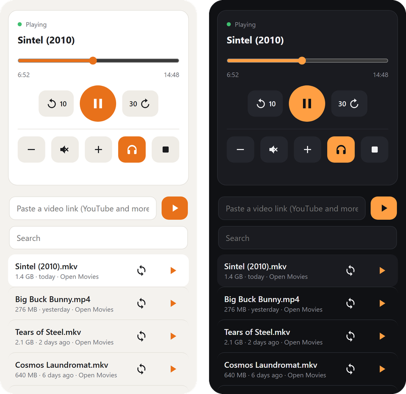
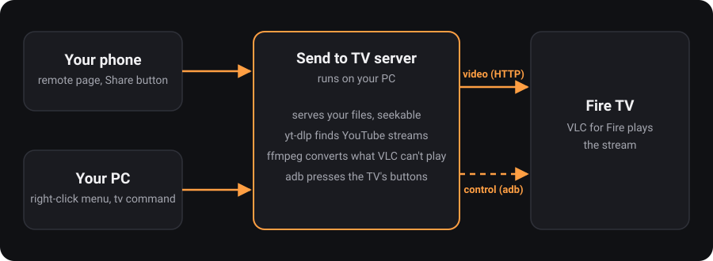

# Send to TV

Play videos from your Windows PC on a Fire TV: right-click a file and choose **Send to TV**, or use the
remote page from your phone. No casting protocol and no app to build for the video itself. The PC serves the
file over HTTP (with range requests, so seeking works) and tells VLC on the TV to open it, over network adb.

<p align="center">
  
</p>

<p align="center"></p>

- Right-click menu for video files (Windows 11: under "Show more options").
- Remote page on your phone or laptop: play, pause, seek, volume, library of recent videos.
- Links from YouTube and the other sites yt-dlp supports, no ads. Paste one into the remote page, or share it
  from your phone.
- Files VLC can't decode are converted on the fly with ffmpeg (GPU encoder when available).
- `tv` command line for everything above.
- Optional: a small helper app for the TV that switches Bluetooth headphones and can replace Amazon's ad-filled
  home screen with a photo frame ([details](docs/home-screen.md)).

Developed and tested on a Hisense Fire TV. Other Fire TV devices should work; reports welcome.

## Requirements

- Windows 10 or 11 and [Python](https://www.python.org/downloads/) 3.12 or newer. No Python packages are needed.
- [ffmpeg](https://ffmpeg.org/) (`ffmpeg` and `ffprobe` on PATH), for example `winget install Gyan.FFmpeg`.
- A Fire TV with **VLC for Fire** installed from the Appstore, on the same network as the PC.
- [Node.js](https://nodejs.org/) on PATH if you want YouTube links (yt-dlp needs it for YouTube's scripts).
- Optional: a JDK 17+ and `pip install pillow` if you want to build the helper app and download its photos.

## Set up

1. On the TV: Settings > My Fire TV > About, click the device name 7 times to unlock Developer Options, then
   Settings > My Fire TV > Developer Options > turn **ADB Debugging** on.
2. On the PC:
   ```
   python install.py
   ```
   This downloads adb and yt-dlp into `tools/`, adds the right-click menu, starts the server with Windows,
   and adds the `tv` command (open a new terminal afterwards). `python install.py --uninstall` removes it all.
3. Find the TV, then accept "Allow USB debugging" on its screen the first time (tick "Always allow"):
   ```
   tv find
   ```
   If there is more than one device on your network, set `tv_host` in `config.json` yourself.

Reserve the PC's address in your router, so the remote page and phone shortcuts keep working.

## Use

- Right-click a video > Send to TV.
- Remote page: `tv url` prints the address, for example `http://192.168.1.20:8765/`. Open it on your phone.
- Command line:
  ```
  tv play <file or link> [--start 1:30] [--convert]
  tv pause | resume | toggle | stop | status | list
  tv seek 1:30 | +30 | -10
  tv vol up|down|mute [steps]
  tv headphones on|off
  tv folder add|remove|list <path>
  tv find | url | server
  ```
- The server logs to `logs/server.log`. `install_watchdog.ps1` is an optional scheduled task that restarts the
  server if it ever stops.

### iPhone Share button

Make a Shortcut once, then Share > Play on TV in YouTube or Safari:

1. New shortcut named "Play on TV". In its settings (the "i" button), turn on "Show in Share Sheet".
2. Set it to receive URLs, Safari web pages and text. Under "If there's no input", choose "Get Clipboard".
3. Add "Get Contents of URL": `http://<your PC's address>:8765/api/play`. Method POST, Request Body JSON, one
   Text field: key `url`, value "Shortcut Input".

## Settings

`config.json` is created on first run and is yours alone (it is not part of the repository).

| Key | Default | Meaning |
| --- | --- | --- |
| `tv_host` | empty | The TV's address. `tv find` fills it in. |
| `port` | 8765 | Port of the server and remote page. |
| `video_folders` | your Downloads folder | Folders listed on the remote page, newest first. |
| `library_depth`, `library_limit` | 3, 300 | How deep and how many videos the remote page lists. |
| `convert_quality_crf` | 20 | Quality of converted video. Lower is better and heavier. |
| `stream_max_height` | 1080 | Highest picture height for website links. Raise to 2160 if your TV and Wi-Fi manage 4K. |
| `headphones_name` | empty | Part of your headphones' Bluetooth name. Needed for `tv headphones` and the remote's headphones button, which also need the helper app. |

Videos that need a login (age-restricted, members-only) use a `cookies.txt` in this folder when one exists
(Netscape format, exported from your browser). Netflix, Disney+ and other copy-protected services can't work.

## How it works

One `adb shell` stays open, and key presses go straight to the TV's virtual keyboard device
(`/dev/input/...`, named "amzkeyboard") instead of `input keyevent`, which takes about a second. Skips of
multiples of 10 seconds use VLC's own skip keys, so they don't reload the video; other seeks reopen the link
at the new time. VLC's open player only takes a new link while it is playing, so when it is paused or still
loading the server restarts VLC with the new one. Website videos come as separate picture and sound streams;
ffmpeg copies both into one stream starting at the same keyframe, so they can't drift.

## Security

The server listens on your whole local network and has **no login**. Anyone on your Wi-Fi can open the remote
page, start or stop playback, and stream files from the folders listed in `video_folders`. Run it only on a
network you trust, never expose its port to the internet, and keep `video_folders` to videos. Playing by file
path is accepted from the PC itself only.

## Project layout

```
firetv_cast/   server, TV control (adb), yt-dlp and ffmpeg glue, remote page (web/)
install.py     right-click menu, startup entry, tv command, adb and yt-dlp
tv-helper/     source of the optional TV helper app (Java, built without Android Studio)
tests/         unit tests: python -m unittest
```

## License

MIT, see [LICENSE](LICENSE). The home screen photos are not part of this repository; they are downloaded from
Wikimedia Commons under the licenses listed in `tv-helper/photos.json`.
